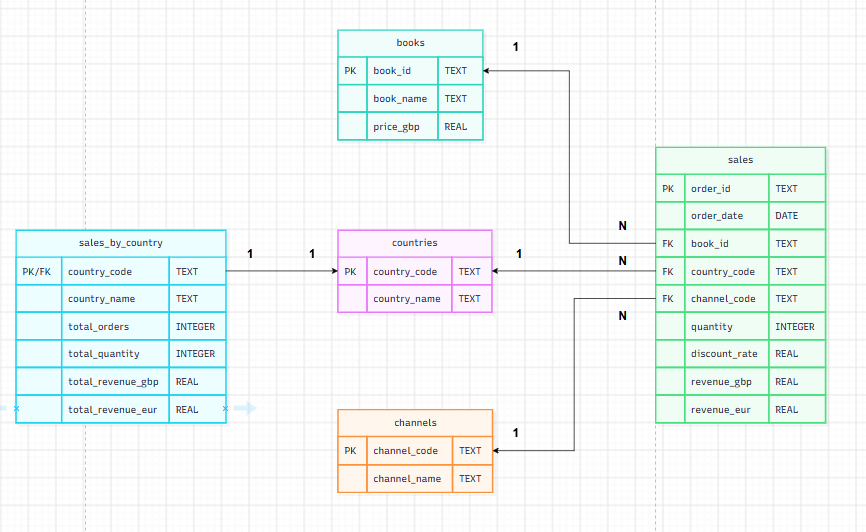

# BookWorld – Pipeline de données et API

Projet d'examen final DataBird. BookWorld est une entreprise fictive de vente de livres en ligne. Le projet
construit un pipeline de données qui :

1. collecte les données de quatre sources différentes ;
2. produit un jeu de données propre des ventes par pays ;
3. crée une base SQL finale, **sans donnée personnelle** (RGPD) ;
4. expose les ventes agrégées par pays dans une **API REST protégée par un token**.

## Vue d'ensemble

```
sales_raw.csv ────────────────┐
bookworld_reference.db ───────┤
books.toscrape.com (scraping) ├──> pipeline.py ──> bookworld_final.db ──> api.py ──> GET /sales-by-country
API Frankfurter (GBP -> EUR) ─┘
```

| Source | Contenu | Utilisation |
|---|---|---|
| `sales_raw.csv` | 240 commandes brutes (avec noms et prénoms des clients) | Ventes à nettoyer |
| `bookworld_reference.db` (SQLite) | Pays et canaux de vente | Enrichissement |
| https://books.toscrape.com/ (page 1) | Titres et prix en pounds de 20 livres | Prix des ventes |
| https://api.frankfurter.dev/ | Taux de change GBP vers EUR | Revenu en euros |

## Prérequis

- **Python 3.10 ou plus récent** (testé avec Python 3.14)
- **Git**
- Une **connexion internet** pour exécuter le pipeline (scraping et taux de change)

## Installation

Les commandes sont données pour **Windows PowerShell**.

```powershell
# 1. Récupérer le projet
git clone https://github.com/dardouriwissam-prog/examen_final.git
cd examen_final

# 2. Créer et activer un environnement virtuel
python -m venv .venv
Set-ExecutionPolicy -Scope Process -ExecutionPolicy Bypass
.\.venv\Scripts\Activate.ps1

# 3. Installer les dépendances
pip install -r requirements.txt
```

`(.venv)` doit apparaître au début de la ligne de commande. Sous macOS ou Linux, l'activation se fait avec
`source .venv/bin/activate`.

## Exécuter le pipeline

```powershell
python pipeline.py
```

Le pipeline enchaîne six étapes, et affiche ce qu'il fait à chaque étape :

1. **Extraction** des quatre sources (CSV, SQLite, scraping, API de taux de change) ;
2. **Nettoyage** des ventes (espaces, types, doublons, valeurs invalides) ;
3. **Enrichissement** : prix, nom du pays, revenus en GBP et en EUR ;
4. **Agrégation** par pays : table `sales_by_country` ;
5. **Création de la base finale** `bookworld_final.db` à partir de `schema_final.sql` ;
6. **Contrôles** : clés étrangères, absence de donnée personnelle, cohérence de l'agrégat avec le détail.

Résultat attendu à la fin (les montants en euros varient avec le taux de change du jour) :

```
Lignes par table : countries 11 | channels 3 | books 20 | sales 240 | sales_by_country 8
Controle OK : cles etrangeres valides | aucune donnee personnelle | sales_by_country = recalcul SQL depuis le detail
```

Le pipeline peut être relancé autant de fois que nécessaire : la base finale est reconstruite à chaque fois.
En cas de problème (fichier absent, site inaccessible, token manquant...), un message indique **l'étape**, le
**problème** et **que faire**.

## Lancer l'API

### 1. Créer le token

L'accès à `/sales-by-country` est protégé par un token. Il est stocké dans un fichier `.env` (ignoré par Git,
donc jamais publié) :

```powershell
$token = python -c "import secrets; print(secrets.token_urlsafe(32))"
"BOOKWORLD_API_TOKEN=$token" | Set-Content -Encoding ascii .env
```

### 2. Démarrer le serveur

```powershell
python api.py
```

Le serveur écoute sur http://127.0.0.1:8000 (arrêt avec `Ctrl+C`). Le fichier `.env` n'est lu qu'au
démarrage : après avoir changé de token, il faut relancer le serveur.

### 3. Interroger l'API

Dans une **deuxième** fenêtre PowerShell :

```powershell
$token = (Get-Content .env | Select-Object -First 1).Split("=")[1]
curl.exe http://127.0.0.1:8000/health
curl.exe -H "Authorization: Bearer $token" http://127.0.0.1:8000/sales-by-country
```

| Endpoint | Accès | Réponse |
|---|---|---|
| `GET /health` | libre | `{"status":"ok","database":"ok"}` si l'API fonctionne ; erreur 503 avec explication si la base finale est absente |
| `GET /sales-by-country` | token obligatoire | `{"count": 8, "data": [...]}`, une ligne par pays |
| `GET /docs` | libre | documentation interactive (bouton **Authorize** pour saisir le token) |

Codes de réponse de `/sales-by-country` : `200` succès, `401` token absent ou invalide, `503` base finale introuvable
(lancer d'abord `python pipeline.py`).

## Authentification

### Token de l'API

Le client envoie l'en-tête `Authorization: Bearer <token>`. Le token est généré aléatoirement (43 caractères) et
n'est jamais écrit dans le code. Si le serveur n'a pas de token configuré, il refuse **toutes** les requêtes
protégées : l'accès n'est jamais ouvert par oubli. L'API ouvre la base en **lecture seule** et ne publie que la
table agrégée par pays.

### Accès à GitHub : clé SSH ou token

Pour publier le projet (`git push`), GitHub n'accepte plus le mot de passe du compte. Deux méthodes :

**Option A : clé SSH (recommandée, à faire une seule fois)**

```powershell
ssh-keygen -t ed25519 -C "examen-bookworld"
Get-Content $env:USERPROFILE\.ssh\id_ed25519.pub
```

Copier la ligne affichée (la clé **publique**, fichier `.pub`) dans GitHub : *Settings > SSH and GPG keys > New SSH key*.
La clé privée (`id_ed25519`, sans `.pub`) ne se partage jamais. Puis :

```powershell
ssh -T git@github.com
git remote add origin git@github.com:dardouriwissam-prog/examen_final.git
git push -u origin main
```

**Option B : token d'accès personnel (HTTPS)**

Créer un token dans GitHub : *Settings > Developer settings > Personal access tokens*, avec le droit
*Contents : Read and write* sur le dépôt. Puis :

```powershell
git remote add origin https://github.com/dardouriwissam-prog/examen_final.git
git push -u origin main
```

Quand Git demande un mot de passe, saisir le **token**. Un token ne doit jamais être écrit dans un fichier du projet.

## Fichiers du projet

| Fichier | Rôle |
|---|---|
| `pipeline.py` | Pipeline complet : extraction, nettoyage, enrichissement, agrégation, création et contrôle de la base finale |
| `api.py` | API REST FastAPI (`/health`, `/sales-by-country`) avec authentification par token |
| `queries.sql` | Les 5 requêtes SQL du projet : 2 d'extraction (dont une avec filtre) et 3 de contrôle de la base finale |
| `schema_final.sql` | Structure de la base finale : 5 tables, clés primaires, clés étrangères, contraintes |
| `sales_raw.csv` | Ventes brutes (données fictives, contiennent des noms de clients) |
| `bookworld_reference.db` | Base SQLite de référence : pays et canaux |
| `bookworld_final.db` | Base finale produite par `pipeline.py`, sans donnée personnelle |
| `requirements.txt` | Dépendances Python avec leurs versions exactes |
| `schema_base_finale.png` | Schéma de la base finale (réalisé avec draw.io) |
| `.gitignore` | Fichiers non publiés : environnement virtuel, fichier `.env` du token |
| `.env` | Token de l'API, **créé localement, jamais publié** |

Toute la configuration (noms de fichiers, adresses web, monnaies, délais) est regroupée **en haut** de
`pipeline.py` et d'`api.py` : un changement d'adresse ou de nom de fichier ne demande de modifier qu'une ligne.

## Base de données finale



| Table | Clé primaire | Contenu |
|---|---|---|
| `countries` | `country_code` | Pays (11, dont les Pays-Bas absents du référentiel) |
| `channels` | `channel_code` | Canaux de vente actifs (WEB, APP, MKT) |
| `books` | `book_id` | Livres : titre et prix en pounds |
| `sales` | `order_id` | Une ligne par commande (240), sans nom ni prénom |
| `sales_by_country` | `country_code` | Résultat final : une ligne par pays (8) |

Colonnes de `sales_by_country`, dans l'ordre : `country_code`, `country_name`, `total_orders`, `total_quantity`,
`total_revenue_gbp`, `total_revenue_eur`.

## RGPD

Le fichier brut contient le **nom et le prénom** des clients. Ces données ne sont pas nécessaires à l'usage final
de la base (suivre les ventes par pays) : elles ne sont donc **pas conservées** (principe de minimisation, article 5
du RGPD). La protection est intégrée à la conception : aucune colonne de nom ou de prénom dans `schema_final.sql`,
une liste blanche des colonnes copiées dans `pipeline.py`, et un contrôle qui bloque la création de la base si une
colonne suspecte apparaît. Le numéro de commande est conservé : la base est *pseudonymisée* plutôt que strictement
anonyme tant que le fichier brut existe.

## Limites et améliorations possibles

- Le taux de change est celui du jour d'exécution : les montants en euros changent d'un jour à l'autre. Utiliser le
  taux historique de chaque date de commande serait plus rigoureux.
- Seule la première page du catalogue est scrapée, comme demandé.
- Un seul token partagé, en HTTP local : une mise en production demanderait HTTPS et une gestion des tokens.
- Les colonnes de `sales_by_country` sont décrites à trois endroits (`schema_final.sql`, `pipeline.py`, `api.py`) et
  doivent évoluer ensemble.

## Dépannage

| Message ou symptôme | Cause et solution |
|---|---|
| `Token manquant` ou `Token invalide` | Envoyer l'en-tête `Authorization: Bearer <token>` avec le token du fichier `.env` |
| `Le serveur n'a pas de token configure` | Créer le fichier `.env` (voir plus haut), puis relancer `python api.py` |
| `[Errno 10048]` au démarrage de l'API | Le port 8000 est déjà utilisé : arrêter l'ancien serveur avec `Ctrl+C` |
| `Base finale introuvable` | Lancer d'abord `python pipeline.py` |
| `ERREUR reseau` pendant le pipeline | Vérifier la connexion internet et les adresses en haut de `pipeline.py` |
| `IndentationError` après une modification | Contrôler le fichier avec `python -m py_compile nom_du_fichier.py` |
